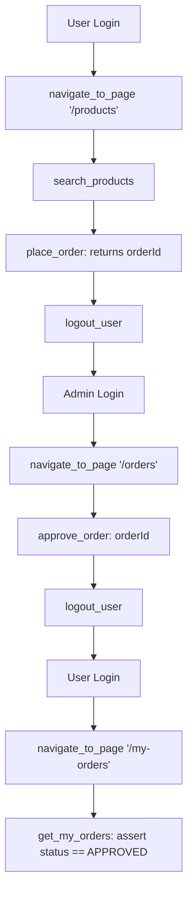

# WebMCP Automation Skill

This skill guides PostQode agents in discovering, invoking, and validating native WebMCP browser tools via `document.modelContext`.

---

## 1. Core Principles of WebMCP Automation

1. **Zero DOM Scraping**: Never query buttons, form inputs, or table rows using CSS/XPath selectors once inside an authenticated session.
2. **Deterministic Schemas**: Tools describe their expected inputs using JSON Schema (`inputSchema`). Validate arguments against this schema before execution.
3. **Sub-Second Execution**: WebMCP tool calls run natively in the page JavaScript runtime without waiting for CSS transitions, hydration delays, or debounces.

---

## 2. API Usage Patterns (Playwright)

### A. Discover Registered Tools
Always retrieve the tools currently registered in the active document scope:

```typescript
const tools = await page.evaluate(async () => {
  return await document.modelContext!.getTools();
});
```

### B. Execute a Tool
> [!IMPORTANT]
> The first argument to `executeTool()` must be the **`RegisteredTool` object**, NOT a string name. Chromium returns results as a **serialized JSON string**. Always parse the output.

```typescript
const rawResult = await page.evaluate(async ({ targetPath }) => {
  const tools = await document.modelContext!.getTools();
  const tool = tools.find((t) => t.name === 'navigate_to_page');
  if (!tool) throw new Error('Tool navigate_to_page not registered');
  return await document.modelContext!.executeTool(tool, { path: targetPath });
}, { targetPath: '/products' });

const result = typeof rawResult === 'string' ? JSON.parse(rawResult) : rawResult;
```

---

## 3. Registered Tool Catalog in PostQode Nexus

### Global Scope (`Layout.tsx`)
* **`navigate_to_page`**: Client-side router navigation.
  * Inputs: `{ path: string }` (`/dashboard`, `/products`, `/orders`, `/my-orders`)
* **`get_current_user_profile`**: Current auth state, permissions, role (`ADMIN` vs `USER`).
* **`logout_user`**: Logs out the current session and redirects to `/login`.

### Product Catalog (`ProductCatalogPage.tsx`)
* **`search_products`**: Queries catalog with optional keyword filtering.
  * Inputs: `{ search?: string, status?: string, categoryId?: string }`
* **`get_product_details`**: Fetches item price and real-time inventory count.
  * Inputs: `{ productId: string }`
* **`place_order`**: Places purchase order for specified quantity.
  * Inputs: `{ productId: string, quantity: number }`
  * Returns: `{ status: 'success', order: { id: string, status: 'PENDING', ... } }`

### Order Management (`OrderManagementPage.tsx` - Admin Only)
* **`get_orders`**: Lists orders with optional filter (`PENDING`, `APPROVED`, `REJECTED`).
* **`approve_order`**: Approves a pending order and decrements stock.
  * Inputs: `{ orderId: string }`
* **`reject_order`**: Rejects a pending order without stock modification.
  * Inputs: `{ orderId: string }`

### My Orders (`MyOrdersPage.tsx` - User Only)
* **`get_my_orders`**: Lists all purchase orders placed by the current user.

---

## 4. Multi-Step Lifecycle Workflow



---

## 5. Execution Reference (Always Headed)

The project includes pre-built, fully validated scripts for this lifecycle in `frontend/`:
* **Run WebMCP Flow (Headed):** `cd frontend && npm run demo:webmcp`
* **Run Traditional Flow (Headed):** `cd frontend && npm run demo:traditional`
* **Run Side-by-Side (Headed):** `cd frontend && npm run demo`

Always run in **headed mode** so the browser opens visibly on screen for clients/users.

